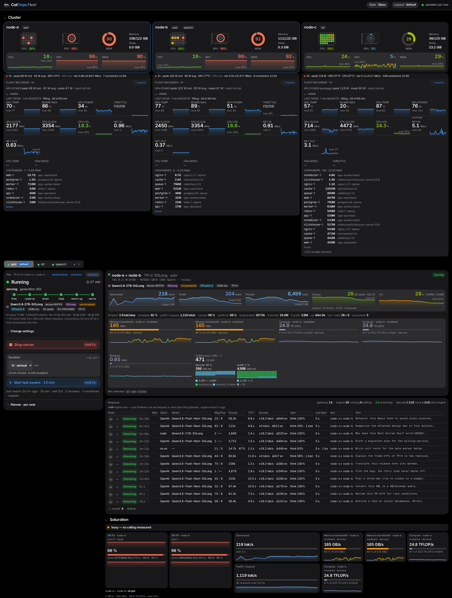
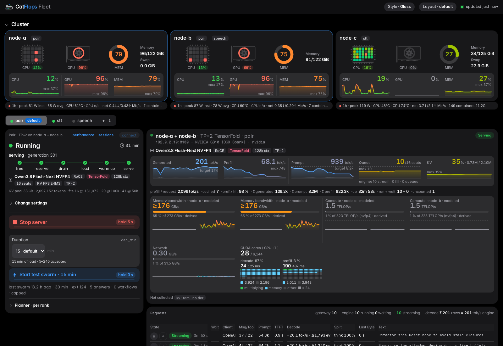
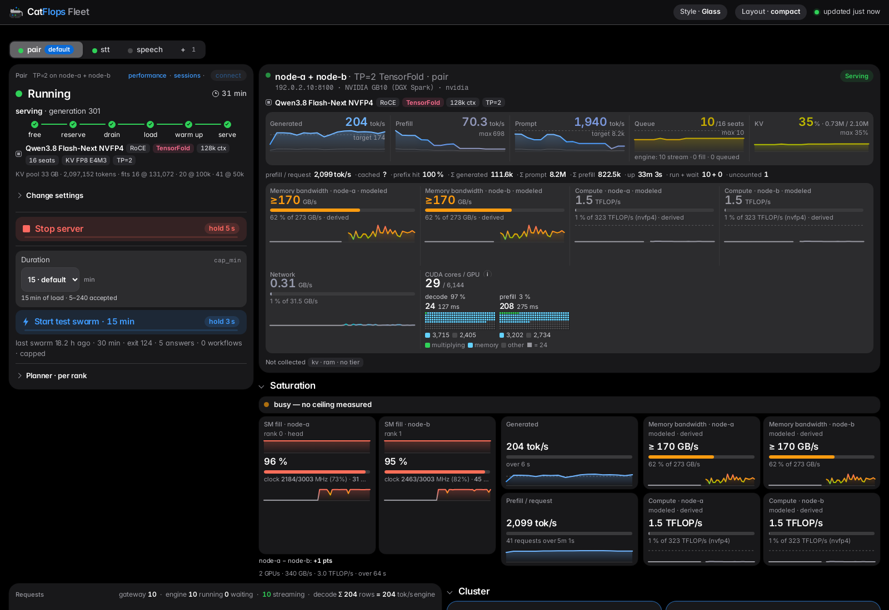
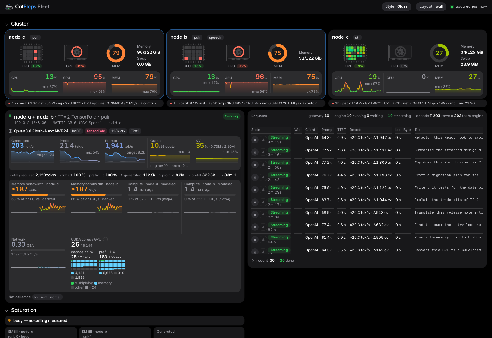
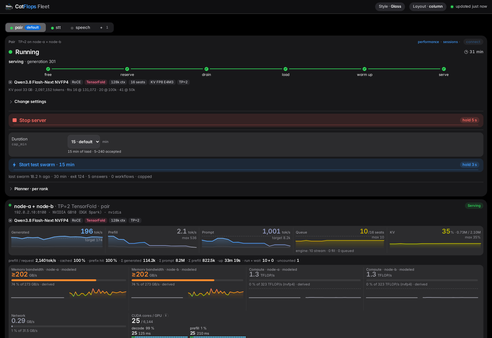

<div align="center">


# catflops_fleet

**An always-on gateway and control panel for the LLM servers you run yourself.**

[](LICENSE)
[](#quickstart)
[](#quickstart)
[](CHANGELOG.md)
[](#hand-it-to-a-coding-agent)

[Quickstart](#quickstart) · [How it works](#how-it-works) · [Docs](#documentation) · [License](#license)

</div>

catflops_fleet sits in front of self-hosted vLLM, SGLang and TensorFold servers and speaks both the
Anthropic `/v1/messages` and the OpenAI `/v1/chat/completions` APIs, so Claude Code, OpenAI-style clients and
any chat front-end share one endpoint. A panel on the gateway starts and stops a two-box tensor-parallel
cluster, shows what each box's memory, bandwidth and compute are doing, and answers Claude Code's server-side
web search itself. **This repository runs no inference engine**: it routes to the servers you name.

> **No authentication is implemented.** No service here signs users in or checks who is calling: anyone who can
> reach the gateway (`:8010`), its panel or usage-mcp can send requests, start or stop models and kill requests.
> The power panel only accepts requests carrying your proxy's shared secret (`X-Power-Gate`) — a check that the
> request came through your proxy, not a sign-in. Everything binds `127.0.0.1` for that reason. Before any other machine can reach it, put your own authenticating reverse proxy in front
> ([Security model](#security-model--read-before-you-expose-anything)).

> **Beta.** One fleet runs every service here in production daily, but the configuration surface (the fleet
> YAML, the hardware types, the per-service `.env` files) is still settling and may change between beta releases.

- **One endpoint, two APIs.** Anthropic and OpenAI wire formats, streaming, tool use, server tools.
- **A fleet is YAML, not code.** Boxes, cards, clusters and who controls them live in one gitignored file;
  nothing about your hardware is compiled in, and a missing value stops the service by name.
- **No fallbacks.** No backend live means 503 with the reason — never a stand-in model or a cached number.
- **No auth built in; everything binds `127.0.0.1`.** You put your own authenticating proxy in front.


Each box's **flight recorder** opens under its card — the last hour of power, temperatures, clocks, CPU, network and the containers it runs, from the box's own telemetry sender (`lb/fleet_telemetry`):



The panel's arrangement is yours: **Layout** in the header picks a template (`lb/vllm_lb/static/layouts/*.json` —
`default`, `compact`, `wall`, `column`; `index.json` names them, the first is what a fresh browser gets) or opens
edit mode — drag a tile's grip, or its arrows (keyboard and touch), full/half width, hide, column widths, more
rows and columns — and exports/imports the arrangement as JSON. The server stores none of it: the chosen template
and the arrangement live in that browser's `localStorage`, and a browser that keeps nothing says so.

<table>
  <tr>
    <td align="center" width="25%"><a href="docs/images/layout-default.png"></a><br><b>Default</b></td>
    <td align="center" width="25%"><a href="docs/images/layout-compact.png"></a><br><b>Compact</b></td>
    <td align="center" width="25%"><a href="docs/images/layout-wall.png"></a><br><b>Wall</b></td>
    <td align="center" width="25%"><a href="docs/images/layout-column.png"></a><br><b>Column</b></td>
  </tr>
</table>

Your own template — the format, the element ids, and the rules for vibe coding one with an agent:
[docs/guides/layout-templates.md](docs/guides/layout-templates.md).

---

## Contents

- [Quickstart](#quickstart)
- [How it works](#how-it-works)
- [The services](#the-services)
- [Configuration](#configuration)
- [The tensor-parallel pair](#the-tensor-parallel-pair)
- [broker_parrot is opt-in](#broker_parrot-is-opt-in--lb_broker_enabled)
- [Security model](#security-model--read-before-you-expose-anything)
- [Hand it to a coding agent](#hand-it-to-a-coding-agent): the setup wizard, `SETUP.md`
- [Tests](#tests) · [Documentation](#documentation) · [Contributing](#contributing) · [License](#license)

---

## Quickstart

Needs: Docker with Compose v2, and at least one vLLM (or SGLang) server reachable over HTTP. No GPU is
needed where the gateway runs. broker_parrot (below) is **not** needed: it is off unless you turn it on.

```sh
git clone https://github.com/robertziel/catflops_fleet && cd catflops_fleet
cp lb/.env.example lb/.env && chmod 600 lb/.env
# in lb/.env:
#   SEARXNG_SECRET=<openssl rand -hex 32>                      (required)
#   LB_ALLOWED_HOSTS=loopback      (required: the names it answers to beyond 127.0.0.1:8010 — lb/.env.example)
cp lb/fleet.example.yml lb/fleet.yml       # your boxes, their cards, the cluster and classic servers (YAML)
cd lb && docker compose up -d --build --wait
curl -s http://127.0.0.1:8010/lb/status | head -c 400; echo
```

Point clients at `http://127.0.0.1:8010` — Claude Code: `ANTHROPIC_BASE_URL=http://127.0.0.1:8010`;
OpenAI clients: base URL `http://127.0.0.1:8010/v1`. The gateway page is `http://127.0.0.1:8010/`.
Every knob is listed, with its default, in `lb/.env.example`; every box, card and cluster in
`lb/fleet.example.yml` (a one-box fleet: `lb/fleet.one-host.example.yml`; a discrete-GPU node:
`lb/fleet.amd-node.example.yml`).

**A chat front-end is a separate project**, catflops_chat: this repository ships none. Any OpenAI- or
Anthropic-compatible client works against the gateway (`:8010`, `/v1/chat/completions` and `/v1/messages`) —
Claude Code, the OpenAI and Anthropic SDKs, `curl`, or a web chat of your own pointed at it.

## How it works


- **Routing.** Every request goes to a live backend the fleet file names; the `model` in the request is
  rewritten to what that backend serves. With nothing live the gateway waits (`LB_ADMISSION_WAIT_S`) and then
  answers 503 with the reason. `/lb/status` shows backends, demand and — with the broker on — leases.
- **The pair.** One switch on the panel (or `POST /lb/cluster`) runs a model tensor-parallel across two boxes.
  The gateway picks the model from its library (`lb/vllm_lb/library`: models, recipes, measurements), RESOLVES
  it on the cluster's cards — engine × accelerator × platform → image, or a refusal naming the missing piece —
  asks each box whether it HAS the checkpoint (`checkpoints` in the fleet file), estimates the per-box memory
  cost before starting, starts one rank per box by running `lb/cluster/tp-rank` over SSH (told the topology as
  facts), and routes to the pair once its head answers `/health`.
- **Five axes, five libraries.** Model (read from its `config.json`), engine (capabilities as YAML, behaviour
  as code), accelerator (what kernels target: `hardware/accelerators`), card type (one product:
  `hardware/types`), topology (one card · TP within a host · TP across hosts). An image is the matrix's for
  engine × build × accelerator × platform; a model never measured on your accelerator is refused unless you
  start it explicitly sized by the estimate. Design: [docs/design/engines.md](docs/design/engines.md); new
  hardware: [docs/guides/bring-your-own-hardware.md](docs/guides/bring-your-own-hardware.md).
- **Reference setups (blueprints).** The project's proven setups by hardware type — a model and every knob its
  target's Start takes, for an accelerator × TP and control, with the source of its numbers — in
  `lb/vllm_lb/library/blueprints/`. They are for the coding agent running the setup wizard, not a runtime choice: it
  offers the ones that fit your answered hardware and prefills your answers from the one you pick, which you confirm
  or edit; what it renders is plain fleet settings. The library stays measured fact. See
  [Reference setups (blueprints)](#reference-setups-blueprints).
- **Hardware tiles.** Memory, bandwidth, compute and KV-pool per box, modeled from the engine's own counters
  where it exposes them and labelled "not exposed" where it does not; the hardware facts come from
  `lb/vllm_lb/hardware/types/*.yml`, every figure with its source.
- **Web search.** Claude Code's `WebSearch` is a server-side tool: the gateway recognises the
  `web_search_20250305` request, queries its bundled SearXNG and synthesises the `server_tool_use` +
  `web_search_tool_result` blocks, so the native tool works with no client configuration.

### Reference setups (blueprints)

Two reference setups ship, this project's own production setups, named by hardware type and model
(`lb/vllm_lb/library/blueprints/<id>.yml`, each citing what it ran and the measurement it is sized by):

| id | hardware · control | model | engine | seats × context | KV |
|---|---|---|---|---|---|
| `2x-gb10-qwen3.8-flash-next-hibrid48` | 2× GB10 (`nvidia-sm121`, TP=2) · ssh pair | Qwen3.8 Flash-Next hibrid48, uncensored | vLLM `fleet` | 12 × 131,072 | fp8_e4m3, 28 GB pool; prefill 4,096; MTP depth 4 |
| `1x-rtx5090-qwen3.8-27b-nvfp4` | 1× RTX 5090 (`nvidia-sm120`, TP=1) · one-host node | Qwen3.8 27B NVFP4, uncensored | vLLM `priority` | 32 × 98,304 | fp8_e4m3, 8,501,810,176 B pin; 32 GiB host-RAM tier |

```yaml
# lb/vllm_lb/library/blueprints/2x-gb10-qwen3.8-flash-next-hibrid48.yml
label: "2× GB10 (DGX Spark) · Qwen3.8 Flash-Next hibrid48 · TP=2"
source: "running in production on 2× DGX Spark: generation 285, 2026-10-30 …"
target: {accelerator: nvidia-sm121, tp: 2, control: ssh}
model: qwen3.8-flash-next-hibrid48
uncensored: true
estimated: false
knobs: {max_num_seqs: 12, max_model_len: 131072, max_num_batched_tokens: 4096, num_speculative_tokens: 4,
        kv_cache_dtype: fp8_e4m3, kv_cache_memory: 28000000000, ple_replicate: false, kv_offload_gib: 0,
        long_prefill_token_threshold: 0}
```

Every knob is written out (a knob the engine does not take is `null`; a node's `null` is the engine's own), and each
file is held to the model library, the image matrix and the measurements by `lb/tests/test_blueprints.py`. A
blueprint is the setup wizard's starting point ([SETUP.md](SETUP.md)), never something the gateway starts: the agent
asks `cluster.blueprint` ("start from a reference blueprint?") with the ones whose target is your answered cards and
control, then shows what it proposes for your answers:

```sh
docker run --rm -v "$PWD":/repo:ro -w /repo python:3.12-slim \
  python deploy/setup/render.py deploy/setup/answers.yml --prefill
```

```
REFERENCE BLUEPRINTS (lb/vllm_lb/library/blueprints) — by each cluster's answered control and cards
  pair: 2x-gb10-qwen3.8-flash-next-hibrid48 — FITS: 2× GB10 (DGX Spark) · Qwen3.8 Flash-Next hibrid48 · TP=2
cluster.first_model: {pair: "qwen3.8-flash-next-hibrid48@uncensored"}    # unanswered
cluster.first_start_settings: {pair: {"max_num_seqs": 12, "max_model_len": 131072, …}}    # unanswered
cluster.kv_cache_dtypes: {pair: ["fp8_e4m3"]}    # unanswered
```

You confirm or edit each; the sheet then renders plain settings into `lb/fleet.yml` (a node's launch block, a pair's
choices and KV dtypes) and the pair's first Start. A fleet file naming a blueprint is refused at boot.

### Engines

![Engines: a model's recipe names its engine and build; the image matrix resolves the image for the cluster's accelerator and platform; recipes, measurements (engine × accelerator × TP) and the estimate the operator may choose; a request's path picks its task (chat or transcription); the catalog row picks the launch — a TP=2 cluster on vLLM, SGLang or TensorFold, a classic one-box vLLM, or a one-host node whose engine class is VllmEngine, SglangEngine, FasterWhisperEngine or NemoEngine; each engine's KV pool, settings, refused knobs and metrics vocabulary; the /metrics scrape names its own engine and is parsed into one canonical scrape](docs/images/engines.svg)

### Hardware


### Panel styles

| key | label | look |
|---|---|---|
| `vibe` | Vibe coded | dark, the original |
| `clean` | Clean | light, quiet |
| `mono` | Mono | monospace, dark |
| `glass` | Glass | translucent; follows the system light / dark |
| `terminal` | Terminal | green-phosphor CRT terminal; one dark appearance |

- **Style menu** in the panel header: each browser picks its own, kept in its `localStorage` only.
- **Deployment default**: `lb/fleet.yml` `panel: {style: <key>}` (required). It is shown to every browser that has
  not picked one, applied before first paint, and tagged `default` in the menu.
  The examples and the setup wizard ship `glass`.
- Adding a style, the token list, the tests that gate it: [docs/guides/panel-styles.md](docs/guides/panel-styles.md).

## The services

| Piece | What it is |
|---|---|
| `lb/` — **vllm-lb** (`:8010`) | The always-on gateway: routing, the cluster control plane, the panel, hardware telemetry, benchmarks and swarms, SearXNG (`127.0.0.1:8811`). |
| `power/` — **vllm-power** (`:8016`) | Wake-on-LAN and shutdown of the fleet's boxes; dry-run unless `POWER_DRY_RUN=0`; answers only the front proxy carrying its secret. |
| `usage-mcp/` | The fleet's own usage data as read-only MCP tools. |
| `deploy/` | Image recipes (SGLang TP=2 with patches, TensorFold native, GLM / DeepSeek cluster vLLM), checkpoint staging, the standalone one-box fleet (`deploy/standalone/`), example edge vhosts and frpc tunnels, and `deploy/tests` — the publishability guards. |
| `dashboard/` | Legacy: polls the vLLM servers named in `VLLM_SERVERS`. |

## Configuration

Nothing about your machines ships in code, compose files or the installer. Each service reads its own
gitignored env file; the `.env.example` next to it is the list of what that service needs:

| file (copy from its `.env.example`) | read by | what goes in it |
|---|---|---|
| `.env` (repo root) | `dashboard/.env` (a symlink, for compose interpolation); the `frpc` client of `power/` | `FRP_SERVER`, `FRP_TOKEN`, `VLLM_SERVERS`, `LB_URL`, `CHAT_MODEL` (the dashboard's) |
| `lb/.env` | `lb/` | `SEARXNG_SECRET` and `LB_ALLOWED_HOSTS` (required), the `LB_CLUSTER_*` tuning knobs; with the broker on, `LB_BROKER_ENABLED=1`, `COMPOSE_FILE`, `LB_BROKER_CHECKOUT`, `LB_BROKER_NETWORK` and `PG_*` (the broker's Postgres) |
| `lb/fleet.yml` | `lb/` (mounted read-only, `LB_FLEET`) | WHAT the fleet is: boxes (hostname, label, ssh), every card (nvidia-smi index, hardware type from `lb/vllm_lb/hardware/types/`, serves), the cluster (ranks, url, control), classic servers and the panel's default style (`panel.style`) — validated at start, refused naming the value (`lb/fleet.example.yml`) |
| `power/.env` | `power/` | `POWER_ORIGINS`, `POWER_ALLOWED_HOSTS` (required), `POWER_BOXES`, `POWER_DRY_RUN` |
| `deploy/*.example.*` | your edge proxy | copy each next to itself without `.example` (gitignored) and fill in your hosts; the `frpc` tunnels read `FRP_SERVER` / `FRP_TOKEN` from the root `.env` |

A variable with no safe default is left empty, and the feature it serves refuses until it is set: the
dashboard stops at boot naming it, and vllm-power refuses every request until its origin is set. An empty allowlist of boxes means
"none", never a stand-in. A retired variable name is refused at boot naming its replacement. The frp token is
needed only by the `frpc` clients, so an unset `FRP_TOKEN` leaves the services themselves running.

## The tensor-parallel pair

Setup, once, for two boxes (`box-a`, `box-b`) joined by a direct link:

1. **A key for the LB.** `ssh-keygen -t ed25519 -N '' -f lb/cluster-ssh/id_ed25519` (gitignored), pin the
   boxes' host keys from your own `known_hosts`
   (`for ip in <box-a-ip> <box-b-ip>; do ssh-keygen -F $ip -f ~/.ssh/known_hosts | grep -v '^#'; done > lb/cluster-ssh/known_hosts`),
   and authorize it: `ssh-copy-id -i lb/cluster-ssh/id_ed25519.pub <user>@<box-a-ip>` and the same for the other box.
   Nothing is installed on the boxes — `lb/cluster/tp-rank` ships in the LB image and runs over SSH.
2. **`lb/fleet.yml`:** the two boxes (`hostname`, `label`, `ssh: <user>@<ip>`, one card with `serves: true`)
   and a cluster with `control: ssh`, `url: http://<box-a-ip>:8100` and both ranks head first with their
   `interconnect` address (`lb/fleet.example.yml` is exactly this shape); then
   `docker compose build vllm-lb && docker compose up -d --wait vllm-lb`.
3. **Use it** from the gateway's panel (or
   `POST /lb/cluster {"enabled": true, "model_choice": "<catalog id>", "max_num_seqs": 16}`).
   The switch is the file `lb/state/cluster.json`, so restarts and redeploys resume it — the chosen model
   included. An id the catalog cannot launch in the cluster is a 400 that says what it does have, and changing
   the model while the pair runs is a 409 (stop it first: both ranks would have to reload).
4. **Before starting**, `GET /lb/cluster/estimate?model_choice=<id>&max_num_seqs=<n>&max_model_len=<n>`
   sizes that selection per box — what it needs, what it leaves, and the warnings — which is what the
   panel shows as you pick. Adding a model is data, no code: its facts in `lb/vllm_lb/library/models.json`
   (`python -m vllm_lb.model_facts <folder>` reads them), its recipe in `recipes.json`, its measured footprint
   in `measurements.json` (keyed engine × accelerator × TP), and its folder in your fleet file's `checkpoints`.

The panel's states: **freeing** (freeing RAM — turns on classic servers ending, memory under the gate) ·
**reserving** (with the broker on: asking it to reserve both boxes) · **waiting** (a reservation not claimable
yet) · **draining** (the fleet's own jobs finishing on a reserved box) · **starting** (both ranks up and loading —
one bar per load pass, never an ETA) · **running** (traffic goes to the pair) · **restarting** · **failed** (a rank
exited — Stop, then Start) · **unknown** (a box cannot be observed; nothing changes until it can) ·
**unloading / releasing** (Stop in progress: ranks go first, the reservations after).

## broker_parrot is opt-in — `LB_BROKER_ENABLED`

[broker_parrot](https://github.com/robertziel/broker_parrot) is a separate job-fleet engine. With it on, the
gateway **leases** a box's server through the broker's queue instead of dialling it directly, so GPU boxes
shared with other work are never fought over.

| | **OFF** — the default: `LB_BROKER_ENABLED` absent, or anything but `1`/`true`/`yes` | **ON** — `LB_BROKER_ENABLED=1` |
|---|---|---|
| compose | `cd lb && docker compose up -d` — `docker-compose.yml` alone; no broker checkout, no Postgres, no external network | `COMPOSE_FILE=docker-compose.yml:docker-compose.broker.yml` in `lb/.env`: the override mounts the engine read-only from `LB_BROKER_CHECKOUT` at `/opt/broker_parrot`, wires the DB (`PG_USER`/`PG_PW`/`PG_DB`, `PG_PW` required) and joins the broker's network `LB_BROKER_NETWORK` |
| engine | `queue_workflows` never imported; the broker DB never read or written | imported and configured by the control loop; a missing mount is a `/lb/status` line, never a crash |
| routing | every live configured backend is routable as it stands; a turn never waits for a claim | leased only: no lease, no traffic; a turn waits up to `LB_ADMISSION_WAIT_S` for a claim on its way |
| cluster Start | launches on what the boxes say: the checkpoint present, memory per rank role, no classic server container up | reserves both boxes through the broker first — one priority node-job per box, released only after both ranks are down |
| `/lb/status` | `"broker": {"enabled": false}` | `"broker": {"enabled": true}` plus `db_ok`, `db_error`, leases, capacity, context, run-next, gpu_slots |

Both lines of ON go together: the switch without the override has no engine to import (`db_ok: false,
engine unavailable`); the override without the switch mounts an engine the LB never imports. OFF is the
operator's explicit choice, not a fallback: an ON gateway whose broker is down says so and refuses to route
unleased.

## Security model — read before you expose anything

* **No authentication is implemented anywhere in this repository.** The gateway (`:8010`) has none of its own. Its control endpoints (`POST /lb/cluster`,
  `/lb/clusters/<name>`, `/lb/swarm/start`) change what runs on your GPUs, and `POST /lb/requests/<id>/kill`
  ends a client's request (the front proxy's `X-Vllm-User` names who, in the log). It publishes on
  `127.0.0.1` only; put an authenticating reverse proxy in front before any other machine can reach
  it — this repository ships none (the fleet it comes from runs a private sign-in service in front; yours is
  yours). State changes are JSON-only, so a page on another site cannot fire them from a browser.
* **Binding 127.0.0.1 does not keep a browser out: every service checks the Host it is reached by.** A page you
  open elsewhere can DNS-rebind its own name to 127.0.0.1 and then reach a loopback port same-origin. So the
  gateway answers only to its listener's loopback names (`127.0.0.1`, `localhost`, `[::1]` at its port) and the
  names in `LB_ALLOWED_HOSTS` (required: your proxy's Host, the docker names containers dial, or `loopback`) —
  anything else is 421 — and refuses a write whose `Origin` is none of them (403). The power panel does the same
  with `POWER_ALLOWED_HOSTS`. Each distinct Host is logged once (`[host] first request with Host …`).
* **The power panel** (`power/`) can power machines off. It is dry-run unless `POWER_DRY_RUN=0`, answers
  only requests carrying the front proxy's secret (`X-Power-Gate`) from `POWER_ORIGINS`, acts only on the
  boxes in `POWER_BOXES`, and its installer (`power/install/host-setup.sh`) ships no key.
* **The UDP hardware intake** (`48291/udp`) is the one port published on all interfaces: it receives
  broadcast telemetry for the hardware panel and is display-only. `LB_HW_PORT=0` turns it off.
* Report a vulnerability privately (see `SECURITY.md`), not in a public issue.

## Hand it to a coding agent

The repo is set up for a coding agent such as Claude Code, Cursor or Codex: every service is one Docker
image whose test suite runs hermetically (no network, no GPU), every deployment value is in a `.env.example`
or a `fleet.example.yml`, and the publishability guards fail the suite the moment a host name or an address
is compiled in. `CLAUDE.md` and `AGENTS.md` carry the conventions.

It does not set the fleet up from a guess: `SETUP.md` is the wizard it follows. It asks you every
deployment choice first (the machines and their cards, the models directory on each, which model each
cluster loads, context length and concurrency, exposure and the sign-in in front, …) from the question
library `deploy/setup/questions.yml`, shows you the whole answer sheet (secrets masked) and waits for your
yes. Then it renders `lb/.env`, `lb/fleet.yml` and the rest with `deploy/setup/render.py`, boots, and
verifies. Paste this prompt:

```text
Set up catflops_fleet (https://github.com/robertziel/catflops_fleet) for me.
Read SETUP.md and run its wizard: ask me every question it lists before writing
any file, show me the answer sheet, and wait for my yes.
```

## Tests

Tests run inside each service's own image, hermetically (no network, no GPU):

```sh
for s in lb power usage-mcp; do docker build -q -t vllm-$s:dev $s; done
docker run --rm -v "$PWD/lb":/app -w /app vllm-lb:dev python -m pytest          # broker tests skip, named
docker run --rm -v "$PWD/power":/app -w /app vllm-power:dev python -m pytest    # likewise usage-mcp
docker run --rm -v "$PWD":/repo:ro -w /repo python:3.12-slim python -m unittest discover -s deploy/tests
for f in lb/tests/*.node.js; do
  docker run --rm -v "$PWD":/repo:ro -w "/repo/${f%%/*}" node:22-slim node "${f#*/}"; done
```

The lb broker tests need a broker_parrot checkout mounted read-only at `/opt/broker_parrot`
(`-v /path/to/broker_parrot:/opt/broker_parrot:ro`); without it they skip, each saying the engine is not
importable, and `lb/tests/test_broker_off.py` runs either way. `lb/pytest.ini` runs on every core
(pytest-xdist); add `-n 0` for a serial run.

## Documentation

- `CLAUDE.md` / `AGENTS.md` — the conventions, the commands and the "a deployment is configuration" rule.
- `SETUP.md` — the setup wizard a coding agent follows: every question (`deploy/setup/questions.yml`) asked
  before a file is written, then rendered by `deploy/setup/render.py`.
- `lb/.env.example`, `power/.env.example`, `.env.example` — every
  variable, with its default and what refuses without it.
- `lb/fleet.example.yml` and its siblings — the fleet file's shape; `lb/vllm_lb/hardware/types/` and
  `hardware/accelerators/` — the card-type and accelerator libraries (AGENTS.md "Hardware").
- `docs/design/engines.md` — the five axes, resolution at Start, the estimate, open items;
  `docs/guides/bring-your-own-hardware.md` — a new card, architecture, engine or model;
  `docs/guides/panel-styles.md` — the panel's styles, the fleet's default, adding a style.
  `docs/guides/layout-templates.md` — the panel's layout templates, their format, vibe coding your own.
- `deploy/standalone/` — a one-box fleet with a systemd applier; `deploy/images/<engine>/` — one Dockerfile per
  engine, a BASE pin per accelerator (`deploy/images/build.sh`), and their NOTICE files.
- `CHANGELOG.md` — what each release changed; `SECURITY.md` — how to report a vulnerability.

## Contributing

Bug reports, hardware types, engine adapters and doc fixes are all welcome.

- **Tests come first.** A change in behaviour comes with the test that pins it down, and the suite runs in
  Docker exactly as `CLAUDE.md` says.
- **A deployment is configuration, never code.** No host, address, domain, path or model choice in code,
  compose, tests or examples — the publishability guards will tell you.
- **No fallbacks.** When the thing asked for is unavailable, fail with the reason.

If catflops_fleet saved you from writing your own gateway, a ⭐ helps others find it.

## License

**Apache-2.0** ([`LICENSE`](LICENSE)) © Robert Zieliński. Use it, modify it and ship it, commercially or not;
keep the license and copyright notice. Third-party parts keep their own terms (`NOTICE`).
